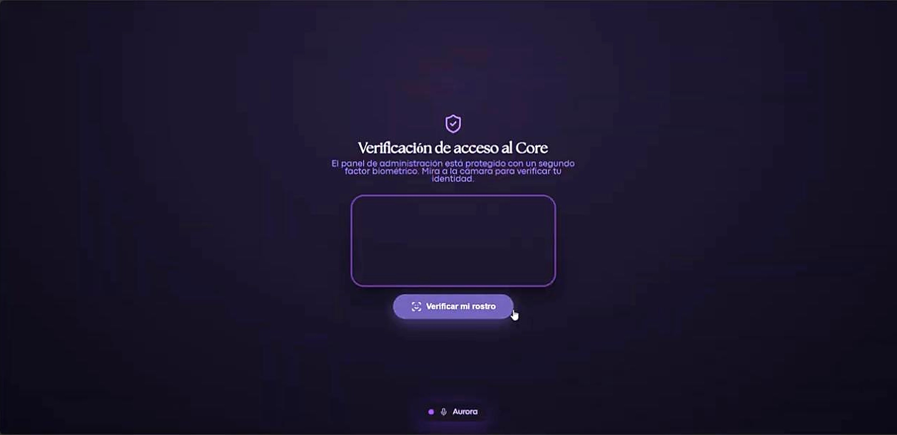
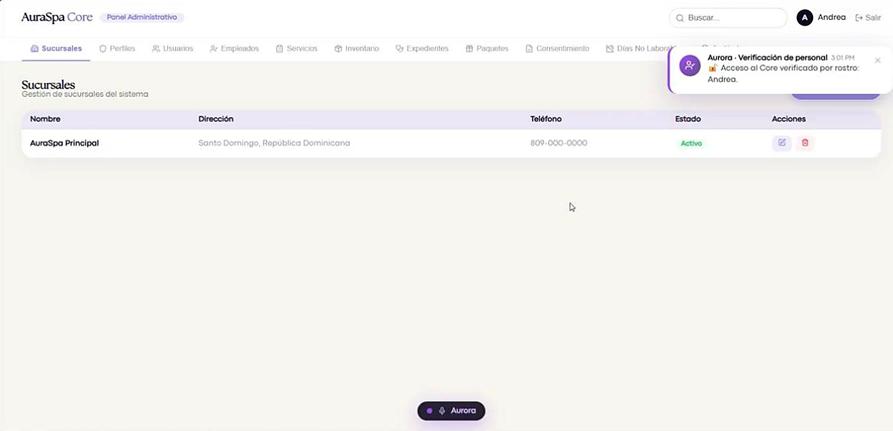
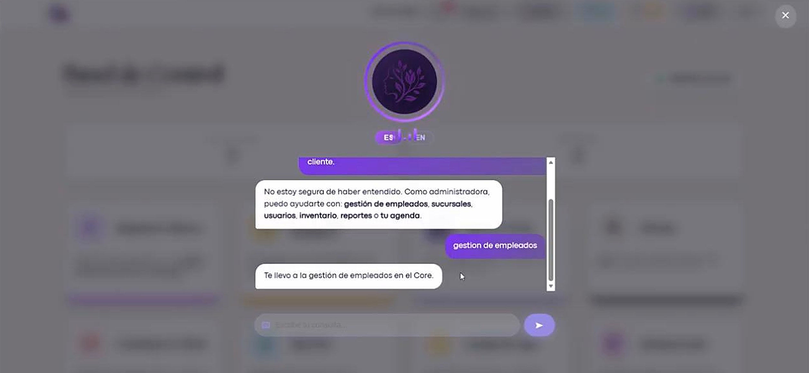
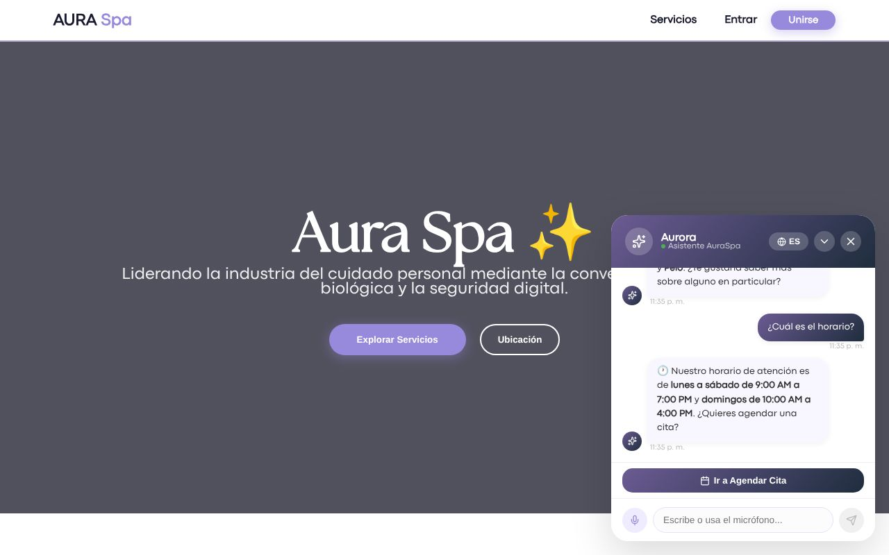
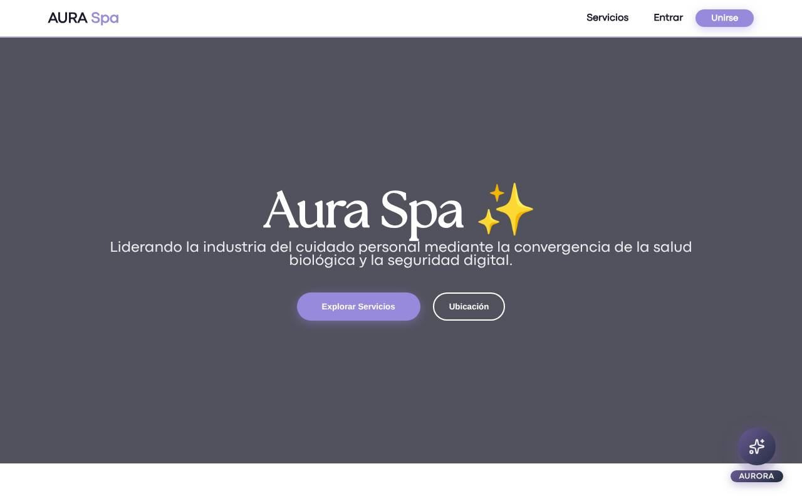
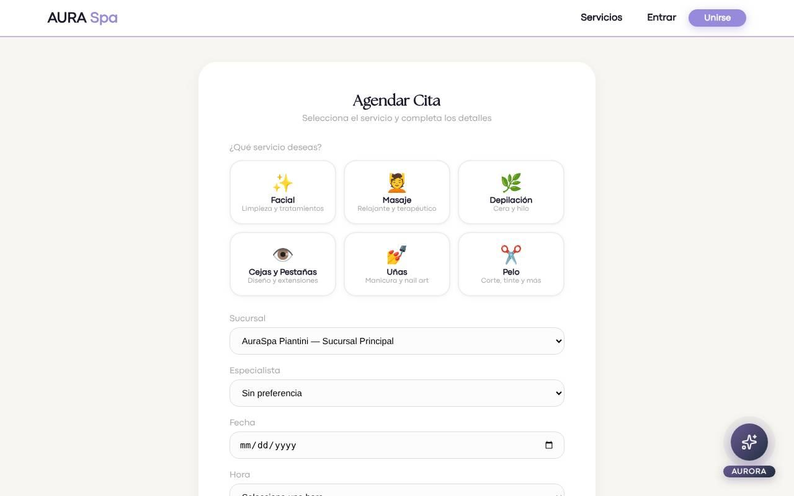
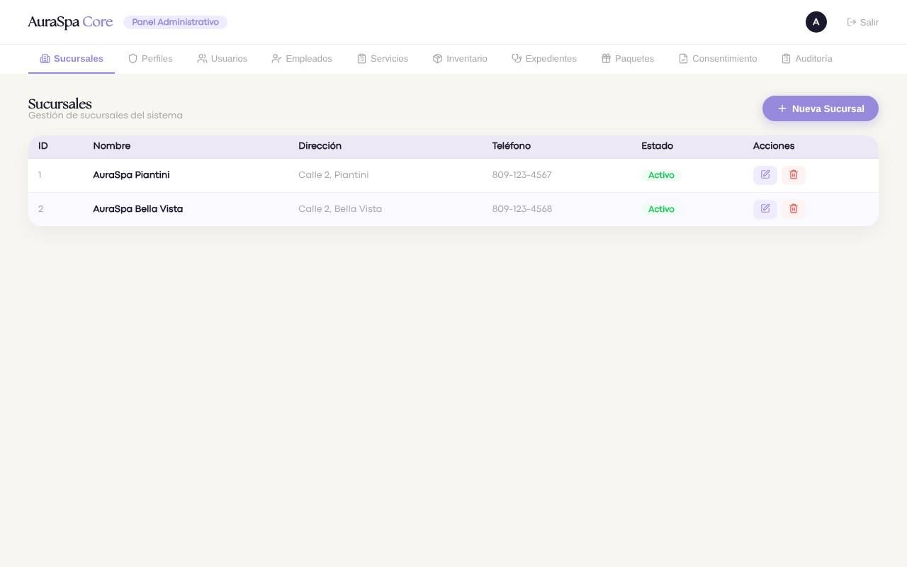
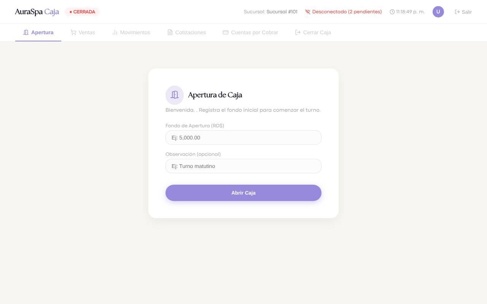

# AuraSpa

Plataforma web para gestionar un spa de punta a punta: citas, caja, inventario, catálogo de servicios y paquetes, expedientes y comprobantes fiscales, con un panel distinto para cada rol (cliente, especialista, cajero y administrador).

Incluye a **Aurora**, una asistente de voz que despierta al escuchar su nombre y responde en español e inglés, y un **acceso al panel administrativo protegido con reconocimiento facial**.


## Proyecto en equipo · mi rol

AuraSpa se desarrolló en equipo (Equipo 5, INTEC). Mi parte fue el corazón técnico del sistema:

- **Base de datos:** diseño del modelo en SQL Server, procedimientos almacenados y datos de prueba.
- **Backend:** API REST en ASP.NET Core (.NET 10) con autenticación JWT y control de acceso por roles.
- **Reconocimiento facial:** segundo factor biométrico para entrar al Core administrativo.
- **Aurora:** la asistente de voz, de principio a fin.

— Gabriela Duverge

## Tecnologías

| Capa | Tecnologías |
| --- | --- |
| Frontend | React, TypeScript, Vite |
| Backend | ASP.NET Core Web API (.NET 10), Entity Framework Core, JWT |
| Base de datos | SQL Server, procedimientos almacenados |
| IA y biometría | Reconocimiento de voz del navegador, reconocimiento facial |

## Estructura

```
backend/AuraSpa.Api   API en ASP.NET Core
frontend/             Aplicación web en React + Vite
database/             Scripts de SQL Server (esquema, procedimientos, datos de prueba)
docs/screenshots/     Capturas del sistema
```

## Cómo ejecutarlo

**1. Base de datos** (SQL Server / SSMS), en este orden:

1. `database/AuraSpa_SSMS_v3.sql`
2. `database/AuraSpa_StoredProcedures_v2.sql`
3. `database/AuraSpa_SeedData.sql`

**2. Backend**

Edita `backend/AuraSpa.Api/appsettings.json`: pon tu servidor en `ConnectionStrings:DefaultConnection` y una clave propia de al menos 32 caracteres en `Jwt:Key`.

```bash
cd backend/AuraSpa.Api
dotnet run
```

**3. Frontend**

```bash
cd frontend
cp .env.example .env.local   # VITE_API_URL apunta a la API
npm install
npm run dev
```

Usuario de prueba: `admin@auraspa.com` / `Admin123!` (datos ficticios).

## Capturas

| | |
| --- | --- |
|  |  |
|  |  |
|  |  |
|  |  |
